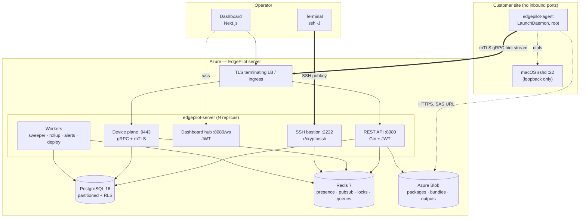
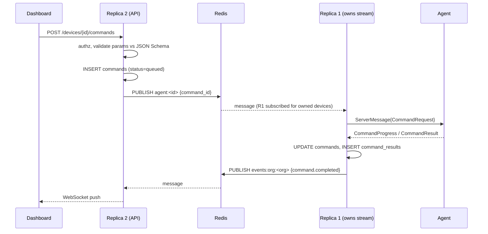
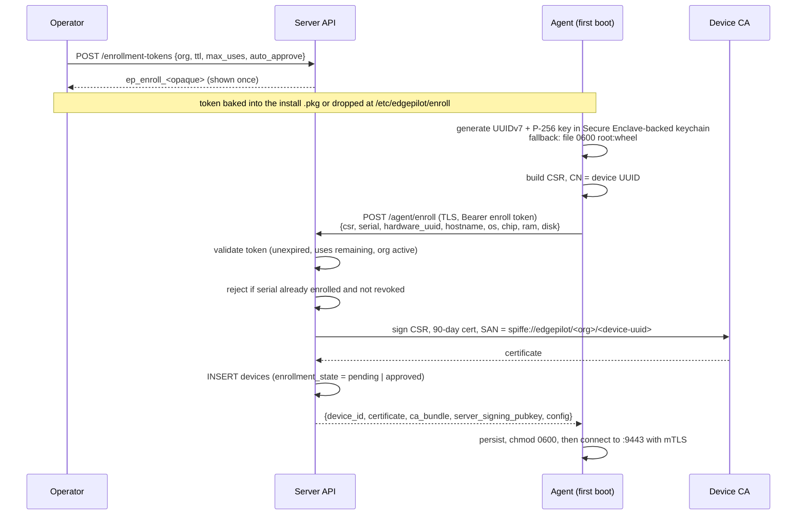
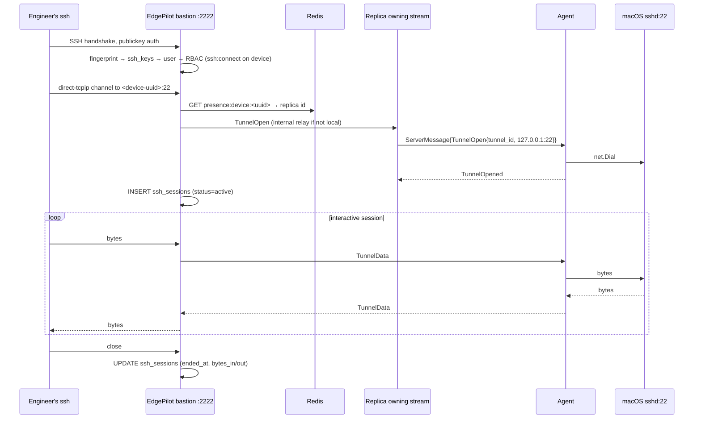

# EdgePilot — Architecture

**Status:** Design, v1.0
**Audience:** Engineers building and operating EdgePilot.

---

## 1. What EdgePilot is

EdgePilot is a self-hosted platform for operating a fleet of Mac mini and Mac Studio
machines installed at customer sites. It gives an operator a single place to see every
device, know its health, run a vetted set of actions on it, move files to and from it,
deploy software to it, and get a real SSH session on it — without any inbound network
access to the customer's network.

**EdgePilot is explicitly not:**

| Not this | Why |
|---|---|
| An MDM | No profile installation, no APNs, no Apple Business Manager, no supervision. EdgePilot manages *machines we own and install*, not user-owned devices. |
| A remote desktop | GUI access is AnyDesk's job. EdgePilot never renders a screen. |
| A general RCE tool | The command surface is an allowlist. Arbitrary shell requires explicit two-person approval and is off by default. |

### 1.1 Deployment shape

- **One management server**, operated by us, hosted in Azure.
- **Multi-tenant**: an `organization` is a customer. Every device, user, package, and
  audit record belongs to exactly one org. Isolation is enforced at the repository layer
  *and* by PostgreSQL row-level security, so a missing `WHERE org_id = ?` is a failed
  query rather than a data leak.
- **N agents**, one per Mac, each holding a single outbound mTLS connection.

### 1.2 Scale target

The design targets **10,000 devices across 500 orgs on a 3-replica server deployment**,
which is roughly 30× the near-term need. The numbers that drive the design:

| Quantity | Value | Consequence |
|---|---|---|
| Metric samples | 1 per device per 30 s | 28.8 M rows/day at 10 k devices → `device_metrics` must be partitioned and rolled up |
| Open agent streams | 10,000 | ~3,400 per replica; goroutine-per-stream is fine, but per-stream buffers must be bounded |
| Heartbeat writes | 10 k / 30 s | Never write `last_seen_at` to Postgres per heartbeat — Redis is the presence store, Postgres is flushed periodically |
| Audit events | ~1 M/day | Append-only, partitioned, hash-chained |

---

## 2. Component map



### 2.1 The four listeners

The server binary exposes four distinct listeners because they have four distinct
authentication models. Collapsing them would mean one compromise surface serves all
identities.

| Listener | Port | Auth | Clients |
|---|---|---|---|
| REST API + dashboard WS | 8080 | JWT bearer (user identity) | Dashboard, CI, `epctl` |
| Device plane | 9443 | mTLS client cert (device identity) | Agents |
| SSH bastion | 2222 | SSH public key (user identity) | Operator terminals |
| Internal relay | 7443 | mTLS, replica CA | Other server replicas |

`/healthz`, `/readyz`, and `/metrics` bind to a separate loopback/admin port (9090) and
are never exposed publicly.

---

## 3. The device plane

### 3.1 Why gRPC bidirectional streaming

Every agent holds exactly one long-lived `Connect(stream AgentMessage) returns (stream
ServerMessage)` call. Everything the agent and server say to each other is a message on
that stream: heartbeats, metric samples, inventory reports, command dispatch and results,
file chunks, log chunks, deployment progress, and raw SSH tunnel bytes.

This is the single most consequential design decision, and it buys:

- **One connection to keep alive, one to firewall, one to observe.** The agent never
  opens a second socket to the server, so the customer's egress rule is a single
  `443/9443 → edgepilot.<domain>`.
- **Typed contract.** `packages/proto` is the source of truth for both sides. Adding a
  message type is a schema change reviewed in one place, not a JSON key that drifts.
- **HTTP/2 multiplexing and flow control for free.** A 2 GB package download progress
  stream cannot starve heartbeats, because gRPC applies per-stream windows.
- **mTLS gives us device identity at the transport layer.** The peer certificate's SAN
  *is* the device UUID. There is no application-level device token to leak, replay, or
  rotate.

The cost is a `protoc` step in CI and no browser-native access — which is fine, since the
browser talks REST and WebSocket to the user plane, never to the device plane.

### 3.2 Connection lifecycle

```
agent boot
  └─ load identity from /var/db/edgepilot/  (uuid, key, cert)
       ├─ absent → enrollment (§4)
       └─ present → dial :9443 with client cert
            └─ send Hello{agent_version, boot_id, last_seq_seen}
                 └─ recv Welcome{server_time, config, resume_from}
                      └─ steady state
```

**Steady state**, from the agent:

| Message | Cadence | Notes |
|---|---|---|
| `Heartbeat` | 15 s | Cheap. Refreshes Redis presence TTL. Never touches Postgres. |
| `MetricsSample` | 30 s | Batched into Postgres via `COPY` by a per-replica flusher. |
| `InventoryReport` | On change + every 6 h | Each section carries a checksum; unchanged sections are skipped. |
| `CommandResult` | On completion | Retried until acked. |

**Backpressure and buffering.** If the server is slow or the stream stalls, the agent
buffers to a bounded on-disk ring (`/var/db/edgepilot/spool`, 64 MiB cap) for
*durable* messages — command results, deployment progress, agent events. *Perishable*
messages — metrics, heartbeats — are dropped oldest-first, because a five-minute-old CPU
reading has no value. This distinction is why the agent's memory ceiling holds during an
outage.

**Reconnect.** Exponential backoff with full jitter, 1 s → 5 min cap. On reconnect the
agent replays unacked durable messages from `last_seq_seen` in the `Welcome`. Message
handling on the server is idempotent by `(device_id, seq)`, so replay is safe.

### 3.3 Presence, and why it is not a database column

`last_seen_at` in Postgres updated on every heartbeat would be 10,000 row updates every
30 seconds — pure write amplification against a table that is also the hottest read path
on the dashboard.

Instead:

- `SET presence:device:<uuid> <replica_id> EX 45` on every heartbeat. Redis is the truth
  for "is it online right now".
- A per-replica flusher writes `last_seen_at` to Postgres in batches every 60 s, so the
  column stays useful for "when did we last hear from a device that is now offline".
- The **offline sweeper** (one leader, elected by a Redis lock) scans for devices whose
  presence key has expired and whose `status` is still `online`, transitions them to
  `offline`, and raises the `device_offline` alert.

### 3.4 Routing across replicas

An agent's stream terminates on exactly one replica. An operator's API request lands on
any replica. Something has to bridge that.



Redis pub/sub is a *notification*, not a queue — it is allowed to be lossy. The durable
state is always the `commands` row. A reconciliation loop on the owning replica sweeps
`status IN ('queued','dispatched')` rows for its own devices every 5 s and re-dispatches,
so a dropped pub/sub message costs latency, never correctness.

---

## 4. Device identity and enrollment

The agent must prove it is a specific device on every connection, and the server must be
able to revoke that proof. Shared secrets and long-lived bearer tokens fail both tests.
EdgePilot runs a **private device CA**.



**Key properties**

- The private key never leaves the Mac. The server sees only a CSR.
- Certificate lifetime is 90 days. The agent renews at 60 days over the *already
  authenticated* stream (`CertificateSigningRequest` → `CertificateResponse`), so renewal
  needs no enrollment token and no operator involvement.
- Revocation is a database state, checked in the mTLS verification callback against a
  Redis-cached revocation set. Revoking a device kills its stream within one heartbeat.
- Enrollment tokens are hashed at rest (only the SHA-256 is stored), scoped to one org,
  TTL-bounded, and use-counted.
- `auto_approve=false` parks the device in `enrollment_state = 'pending'`. It can connect
  and report inventory but receives no commands until an admin approves it. This is the
  default for production orgs.

---

## 5. SSH access

### 5.1 The problem

The Mac has no inbound ports. `sshd` on it listens on loopback only. An engineer needs a
real, interactive SSH session with full audit.

### 5.2 The solution: tunnel over the existing stream, bastion as the entry point



The engineer runs:

```bash
ssh -J ep-bastion.edgepilot.example.com:2222 \
    -i ~/.ssh/edgepilot_ed25519 \
    edgepilot@3f9a1c2e-....   # device UUID or hostname
```

The dashboard's **Copy SSH command** button emits exactly this string; **Open Terminal**
hands it to the OS handler.

### 5.3 Why this shape

- **The bastion never sees plaintext session content.** It relays an *encrypted* SSH
  stream between the engineer's client and the Mac's `sshd`. The inner SSH handshake is
  end-to-end between engineer and device. EdgePilot cannot read the session even if the
  server is compromised — which is the correct property for a vendor-operated control
  plane.
- **The engineer's private key never touches the server.** The bastion authenticates
  the *outer* hop by public key only.
- **`sshd` remains the authority on the device.** We are not reimplementing a shell.
  All of macOS's own auth, logging, and `sudo` policy still applies.
- **Full audit without content capture**: who, which device, which key, from what IP,
  when, how long, how many bytes — in `ssh_sessions`, plus `audit_logs` entries for open
  and close.

### 5.4 Authorized-key reconciliation

For the inner hop to work, the engineer's public key must be in the target account's
`authorized_keys` on the Mac. The agent owns this file:

- The agent reconciles `/var/db/edgepilot/authorized_keys` (referenced from the target
  user's `sshd_config` via `AuthorizedKeysFile`) against the key set the server pushes in
  `ConfigUpdate`.
- The file is agent-owned and fully rewritten each reconcile, so revoking a key in the
  dashboard removes it from every device within one config push.
- Keys carry `expires_at`; expired keys are dropped locally even if the device is offline
  and never receives the revocation.
- Each key is written with SSH restrictions (`no-port-forwarding,no-X11-forwarding`) and
  an `expiry-time=` option, so `sshd` enforces expiry independently of the agent.

### 5.5 Password authentication is disabled

The agent's hardening step sets `PasswordAuthentication no`, `KbdInteractiveAuthentication
no`, `PermitRootLogin no`, and `ListenAddress 127.0.0.1` in a drop-in
`/etc/ssh/sshd_config.d/edgepilot.conf`. Loopback-only binding means that even if the
customer's firewall is wrong, the device is not reachable except through the tunnel.

---

## 6. Command execution

### 6.1 Allowlist first

There is no "run this string" endpoint. A command is an instance of a
**command definition**:

```
command_definitions
  slug                 restart | shutdown | collect_logs | flush_dns |
                       restart_agent | update_agent | install_package |
                       list_processes | restart_service | custom_script
  params_schema        JSON Schema — validated server-side AND agent-side
  required_permission  command:execute | command:destructive | command:custom_script
  requires_approval    bool
  is_destructive       bool
  min_agent_version    semver guard
```

The server sends `CommandRequest{slug, params}`. **It does not send an argv.** The agent
looks the slug up in its own compiled-in handler table and builds the argv itself from
validated parameters.

This is deliberate: a compromised or malicious server can only invoke the finite set of
operations the agent already knows how to perform, with parameters that pass the agent's
own schema check. It cannot turn the fleet into a botnet by sending `/bin/sh -c ...`.

### 6.2 Custom scripts — the deliberate exception

Real operations occasionally need something not in the allowlist. That path exists, and
is expensive on purpose:

1. Requester needs the `command:custom_script` permission (not held by Operator by default).
2. Script is uploaded to object storage; only its SHA-256 enters `commands`.
3. Command enters `pending_approval`. A **different** user with approval rights must
   approve — two-person rule, enforced by a `decided_by <> requested_by` constraint.
4. On approval the server signs `(device_id, script_sha256, command_id, expires_at)` with
   the Ed25519 release key.
5. The agent fetches the script, verifies the SHA-256 *and* the signature against a
   **compiled-in** public key, checks the expiry and that `device_id` is its own, then
   executes with a hard timeout in a scoped environment.
6. Per-device policy `allow_custom_scripts` can disable step 5 outright. Devices at
   sensitive sites are configured this way and will refuse signed scripts.

A stolen database or a compromised API server is not sufficient to run a script — the
signing key is required, and the agent pins it.

### 6.3 Result handling

Progress streams back as `CommandProgress`. Output is capped at 256 KiB inline in
`command_results`; anything larger is uploaded to object storage and referenced by key,
with `truncated = true`. Commands carry `expires_at`; the sweeper marks unclaimed commands
`expired` rather than leaving them queued forever for a device that was decommissioned.

---

## 7. Software deployment

```
software_packages ──< package_versions ──< deployments ──< deployment_status (per device)
```

A deployment is a **plan**, not a broadcast:

1. Operator uploads an artifact. The API returns a SAS URL so a 2 GB `.pkg` uploads
   directly to Blob and never transits the API server. Server records size + SHA-256 and
   signs the digest with the release key.
2. Operator creates a deployment with a target selector (label expression), a strategy
   (`immediate` / `rolling` / `scheduled`), and optionally a rollback target version.
3. The deploy worker materialises one `deployment_status` row per matched device and
   advances devices in batches, honouring `batch_size` and `batch_pause_seconds`.
4. Each device gets an `install_package` command. The agent:
   `queued → downloading` (SAS URL, resumable, checksummed) `→ verifying` (SHA-256 +
   Ed25519 signature) `→ installing` (`installer -pkg` / unarchive + `install_spec`
   hooks) `→ completed`.
5. If the failure rate in a batch exceeds `auto_rollback_threshold`, the worker halts the
   deployment and enqueues the rollback version to already-completed devices.

Rollback works because `deployment_status.previous_version_id` records what was installed
before, per device. Rollback is just a deployment of that version with the same target set.

---

## 8. Logs

Persisting every macOS log line for 10,000 devices is a log-aggregation product, not a
fleet manager. EdgePilot deliberately splits this three ways:

| Need | Mechanism | Storage |
|---|---|---|
| "Show me what's happening right now" | Live tail streamed over the agent stream → dashboard WS | Not persisted |
| "Send me the logs from that incident" | `collect_logs` command → agent builds a bounded, compressed bundle (`log show`, `~/Library/Logs`, `/Library/Logs`, crash reports, agent log) → uploads via SAS URL | Object storage, referenced by a `files` row + `log_collections` job row |
| "Search across the fleet" | Agent ships its own **structured** events (start/stop, command executed, deploy outcome, self-update, tunnel opened) continuously | `device_events`, bounded volume, indexed and searchable |

Full-text search over collected bundles is a Phase 4 concern and is explicitly out of
scope for v1 — the bundle is downloadable and greppable locally, which covers the real
workflow.

---

## 9. Server internals — clean architecture

```
apps/server/
  cmd/server/main.go          composition root: reads config, builds every dependency, wires, runs
  cmd/epctl/main.go           admin CLI: CA init, bootstrap admin, sign releases, migrate

  internal/
    domain/                   ← depends on NOTHING but stdlib
      device.go user.go command.go deployment.go alert.go ssh.go ...   entities + invariants
      repository.go           repository interfaces (DeviceRepository, CommandRepository, ...)
      service.go              service interfaces consumed by transport
      errors.go               domain errors, mapped to HTTP by one middleware

    service/                  ← depends on domain only
      auth/ device/ command/ deploy/ file/ log/ alert/ ssh/ audit/ metrics/ inventory/

    repository/
      postgres/               domain repository interfaces implemented over sqlc-generated code
        queries/              hand-written SQL — the source sqlc generates from
        sqlcgen/              generated; committed, never edited
      redisrepo/              presence, rate limits, cache, revocation set

    transport/
      http/                   Gin: router, handlers, DTOs, middleware — no business logic
      grpc/                   agent stream server, one goroutine set per connection
      ws/                     dashboard hub, Redis-backed fanout
      sshd/                   bastion

    platform/                 infrastructure with no domain knowledge
      ca/ jwt/ crypto/ storage/{azblob,fsstore} logging/ telemetry/ ratelimit/

    bus/                      Redis pub/sub, presence map, replica routing, leader election
    worker/                   sweeper, metric flusher, rollup, retention, alert evaluator,
                              deploy scheduler, audit chain writer
```

**The dependency rule**: `transport → service → domain ← repository`. Nothing in
`domain` imports Gin, sqlc, gRPC, or Redis. `service` accepts interfaces and is
constructor-injected; that is what makes the service layer unit-testable with fakes and
no database.

**Dependency injection is explicit.** `main.go` constructs everything by hand in a
readable ~200-line function. No reflection-based container — the compiler checks the
graph, and the wiring is greppable.

**Errors.** `domain` defines a small set (`ErrNotFound`, `ErrConflict`, `ErrForbidden`,
`ErrValidation`, `ErrUnavailable`) wrapped with context via `fmt.Errorf("%w")`. One HTTP
middleware maps them to RFC 9457 Problem Details. Handlers never build status codes.

**Logging.** `log/slog`, JSON, always structured. Every request carries a `request_id`
propagated through context into service and repository calls, and into the agent stream
for command tracing. No secret, token, key, or password ever reaches a log field —
enforced by a `slog` `ReplaceAttr` redactor keyed on field name.

---

## 10. Dashboard

Next.js App Router, React Server Components for the static shell, client components for
anything live.

```
src/app/
  (auth)/login
  (dashboard)/
    page.tsx                    fleet overview: cards + device table
    devices/[id]/               general · hardware · network · storage ·
                                processes · services · applications · metrics ·
                                files · logs · commands · ssh
    deployments/ packages/ alerts/ logs/ audit/ settings/ users/
src/lib/api/                    client GENERATED from packages/shared/openapi — never hand-written
src/lib/ws/                     typed WebSocket client with reconnect + resubscribe
packages/ui/                    shadcn/ui primitives + EdgePilot components, shared
```

- **State**: TanStack Query for server state; WebSocket events invalidate query keys
  rather than mutating caches directly, so a reconnect self-heals.
- **Auth**: access JWT in memory only; refresh token in an `HttpOnly; Secure; SameSite=Strict`
  cookie. No token in `localStorage` — that is an XSS-to-account-takeover pipeline.
- **Charts**: Recharts against the rollup endpoints, which return pre-bucketed series so
  the browser never downsamples 100 k points.
- **Dark mode** is the default and primary theme; light mode is supported via
  `next-themes`.

---

## 11. Cross-cutting

### 11.1 Configuration

Environment variables only, parsed once into a typed `config.Config`, validated at
startup — the process refuses to boot on a bad or missing required value rather than
failing at first use. Secrets come from environment or Azure Key Vault references; none
have defaults, and none are logged.

### 11.2 Observability

- **Metrics**: Prometheus at `:9090/metrics`. Golden signals per endpoint, plus
  `edgepilot_devices_connected`, `edgepilot_agent_stream_errors_total`,
  `edgepilot_command_duration_seconds`, `edgepilot_deploy_status_total`,
  `edgepilot_tunnel_bytes_total`.
- **Tracing**: OpenTelemetry, trace ID propagated from HTTP through service, repository,
  and into the agent stream via message metadata, so a command's full path is one trace.
- **Health**: `/healthz` is liveness (process up). `/readyz` is readiness (Postgres and
  Redis reachable, migrations at expected version).

### 11.3 Testing strategy

| Layer | Approach |
|---|---|
| `domain` | Pure unit tests, table-driven, no fixtures |
| `service` | Unit tests against in-memory fakes of repository interfaces |
| `repository/postgres` | Integration tests against a real Postgres, one scratch database per test, migrations applied |
| `transport/http` | `httptest` against the real router with fake services; contract-tested against the OpenAPI spec |
| `transport/grpc` | `bufconn` in-process stream, exercising reconnect, resume, and backpressure |
| Agent collectors | Golden-file tests against captured `system_profiler` / `sysctl` output in `testdata` |
| End-to-end | Compose stack + a Linux-buildable agent in "simulator" mode: enroll → heartbeat → command → deploy → tunnel |

The agent's macOS-specific collectors are behind an interface with a `darwin`
implementation and a `simulator` implementation, so the full control-plane path is
testable in Linux CI. Real-hardware verification is a release gate, not a per-commit gate.

### 11.4 Failure modes and what they cost

| Failure | Behaviour |
|---|---|
| Redis down | Presence and pub/sub degrade; API and command queue keep working via Postgres reconciliation. Dashboard live updates stop; polling fallback engages. Not fatal. |
| Postgres down | `/readyz` fails, replica pulled from LB. Agents reconnect elsewhere or backoff. No data loss — agents spool. |
| One replica dies | Its agents reconnect to another within backoff. In-flight commands are re-dispatched by the new owner's reconciliation loop. In-flight SSH sessions drop and must be reopened. |
| Blob storage down | Deployments and log collection fail cleanly with a retryable status. Monitoring, commands, and SSH are unaffected. |
| Agent crashes | LaunchDaemon `KeepAlive` restarts it. Spool on disk survives. `agent_stopped` alert fires if it does not come back within the grace period. |
| Network partition at customer site | Agent spools durable messages, drops perishable ones, reconnects with resume. Device shows `offline`; alert fires. |

---

## 12. Decision log

| # | Decision | Alternative rejected | Reason |
|---|---|---|---|
| 1 | gRPC bidi stream for agents | WebSocket + JSON | Typed schema, flow control, mTLS device identity at transport layer |
| 2 | mTLS device certs from a private CA | Long-lived bearer tokens | Revocable, rotatable, no shared secret, identity is transport-level |
| 3 | SSH via reverse tunnel + bastion | Browser PTY from the agent | Session content stays end-to-end encrypted; `sshd` remains the authority; far smaller blast radius |
| 4 | Redis for presence, Postgres for truth | `last_seen_at` per heartbeat | 10 k row-updates/30 s is write amplification against the hottest read table |
| 5 | Allowlisted slugs, agent builds argv | Server sends argv | A compromised server cannot achieve arbitrary RCE on the fleet |
| 6 | Explicit SQL migrations; sqlc generates query code *from* that SQL | An ORM (`AutoMigrate`, struct-derived queries) | Schema changes must be reviewable, reversible, and identical across environments. Generating Go from SQL — rather than SQL from Go — also makes a column rename a compile error instead of a runtime failure, and leaves `DISTINCT ON`, partial-index upserts, and `COPY` expressible |
| 7 | Multi-tenant with RLS from day one | Add orgs later | Retrofitting tenancy touches every table and every query; RLS turns a forgotten filter into a failed query |
| 8 | Direct-to-Blob via SAS URLs | Proxy uploads through the API | Keeps GB-scale artifacts off the API data path and out of API memory |
| 9 | Partitioned `device_metrics` + rollups | One flat table | 28.8 M rows/day; retention by `DROP PARTITION` is instant, `DELETE` is not |
| 10 | Hash-chained `audit_logs` | Plain append-only table | Makes silent tampering detectable, which is the point of an audit log |
```
