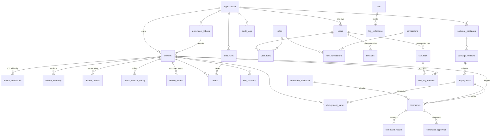

# EdgePilot — Database Design

PostgreSQL 16. Schema lives in `apps/server/migrations` as explicit, reversible
SQL. A production schema change must be reviewable in a diff, reversible, and
byte-identical across dev, staging, and production, so the schema is never
derived from Go structs — no `AutoMigrate`, and no ORM that wants to own the DDL.

Queries go the other way: **[sqlc](https://sqlc.dev) generates Go from SQL**,
reading the same migration files the server ships. The queries this schema needs
are ordinary SQL and awkward-to-impossible in an ORM — `DISTINCT ON` for current
inventory, `ON CONFLICT` against a *partial* unique index for alert dedup, `COPY`
for metric ingest, label selectors over `jsonb`, and `SET LOCAL` for RLS scoping.
Generating from SQL also means a column rename breaks the build rather than a
query at runtime.

Migrations run with [golang-migrate](https://github.com/golang-migrate/migrate),
invoked by `epctl migrate` so the same code path runs in CI, Compose, and Azure.

---

## 1. Entity map



**31 base tables**, plus managed monthly partitions of `device_metrics`,
`device_events`, and `audit_logs`.

Beyond the tables named in the brief, the schema adds: `organizations`,
`permissions`, `role_permissions`, `user_roles`, `enrollment_tokens`,
`device_certificates`, `command_definitions`, `command_approvals`,
`package_versions`, `alert_rules`, `ssh_key_devices`, `log_collections`,
`device_events`, and `device_metrics_hourly`. Each exists because a required
feature has no correct home without it — tenancy, RBAC beyond three hardcoded
roles, revocable device identity, the command allowlist, the two-person rule,
package versioning, and metric retention.

---

## 2. Conventions

| Concern | Rule |
|---|---|
| Primary keys | `uuid`. Insert-heavy tables (`devices`, `commands`) use **UUIDv7** generated in Go, so IDs are time-ordered and B-tree inserts stay at the right edge instead of scattering across the index. `audit_logs` and `device_events` use `bigint identity` — they are append-only and never referenced by FK. |
| Time | `timestamptz`, always UTC. Never `timestamp`. |
| Enumerations | `text` + `CHECK`. A native `ENUM` requires `ALTER TYPE` to extend and cannot drop a value at all; a `CHECK` is a one-line, reversible migration. |
| Soft delete | `deleted_at` on `organizations`, `users`, `devices`, `software_packages` only — entities with history worth keeping. Everything else deletes for real. Uniqueness on soft-deletable tables uses partial indexes (`WHERE deleted_at IS NULL`) so a serial number frees up on decommission. |
| Money/percentages | `numeric` for thresholds (exactness matters for comparison), `real` for telemetry (4 bytes × 28.8 M rows/day matters more than the 7th digit of a CPU reading). |
| JSON | `jsonb`, never `json`. Indexed with `jsonb_path_ops` where queried. |
| Naming | `snake_case`; tables plural; join tables `a_b`; booleans read as assertions (`is_destructive`, `auto_approve`). |
| `updated_at` | Maintained by a trigger, not by application code. Every write path forgetting it once is one silent bug. |

---

## 3. The decisions that matter

### 3.1 `device_metrics` is partitioned, and there is no default partition

1 sample / device / 30 s = **2,880 rows per device per day**. At the 10,000-device
design target that is 28.8 M rows/day and ~2.6 GB/day.

- **Monthly range partitions on `time`.** Retention is `DROP TABLE
  device_metrics_p202601` — instantaneous, no dead tuples, no vacuum storm. The
  same cleanup as `DELETE FROM device_metrics WHERE time < …` would scan and
  rewrite hundreds of millions of rows and leave the table bloated.
- **No `DEFAULT` partition, deliberately.** A default partition silently absorbs
  rows outside the managed range, and once it holds even one row, attaching a new
  partition covering that range requires a full scan and fails on conflict. A
  failed insert is a page, which is what an unmanaged partition range deserves.
  Verified: inserting a sample five years out raises `no partition of relation
  "device_metrics" found for row`.
- **Fixed-width columns only.** No `jsonb` on the hot path.
- **`ensure_monthly_partition(parent, month)`** is idempotent and called by the
  maintenance worker three months ahead. Bootstrap creates four months, so a
  fresh install survives a completely broken worker for a quarter.

### 3.2 Rollups, so charts never scan raw partitions

`device_metrics_hourly` holds avg/max/p95 per device per hour, written by the
rollup worker. `GET /devices/{id}/metrics` reads raw for windows ≤ 48 h and the
rollup beyond, and reports which it used in `source`. A 30-day chart is ~720 rows
instead of 86,400.

Retention: raw 90 days, hourly 400 days. Both configurable per org.

### 3.3 Presence is not a column

`last_seen_at` written per heartbeat would be 10,000 `UPDATE`s every 30 s against
the table the dashboard reads most. Redis holds `presence:device:<uuid>` with a
45 s TTL; a per-replica flusher batches `last_seen_at` into Postgres every 60 s.
The column stays meaningful for "when did we last hear from this device", which
is the only question it needs to answer once the device is offline.

`devices.last_cpu_percent` / `last_memory_percent` / `last_disk_percent` are
denormalised for the same reason: the fleet table renders 500 rows with live
utilisation and must not join a partitioned 28-million-row-per-day table to do it.

### 3.4 Row-level security is the backstop, not the mechanism

The repository layer always filters by org. RLS exists for the day someone forgets.

```sql
SET LOCAL edgepilot.org_id = '<uuid>';   -- set per transaction by the repository
```

`current_org_id()` returns `NULL` when the GUC is unset, and `org_id = NULL` is
never true — so an unscoped connection sees **nothing**. Deny by default.

Two roles: `edgepilot_app` (policies apply) and `edgepilot_admin` (`BYPASSRLS`,
used only by migrations and the cross-org workers, never on a path that accepts
user input).

> A subtlety worth stating because it is easy to get wrong: **enabling RLS grants
> nothing.** A policy only narrows access a `GRANT` already permits. Child tables
> like `device_certificates` need their own `GRANT` alongside their policy, and
> `BYPASSRLS` confers no table privileges either — `edgepilot_admin` needs real
> grants to do its job. Both were caught by executing the migrations rather than
> reading them.

Child tables (`device_certificates`, `command_results`, `package_versions`, …)
inherit tenancy through an `EXISTS` on their parent, which is an index lookup on
the parent's primary key.

`device_metrics` carries no `org_id` on purpose: it is reached by joining
`devices`, which is itself RLS-protected, and a redundant 16-byte column on
28.8 M rows/day buys no security.

### 3.5 The audit log is append-only in the database

`audit_logs` has `BEFORE UPDATE` and `BEFORE DELETE` triggers that raise
unconditionally. Not a convention — a compromised application role cannot rewrite
history without also holding DDL rights to drop the triggers.

Each row carries `hash = SHA-256(prev_hash || canonical_row)`. Removing or
altering a row breaks the chain from that point on, and
`POST /audit-logs/verify` re-walks it and reports the first break. The audit
writer serialises appends per org with `pg_advisory_xact_lock`.

Partition drops still work for retention: dropping a partition is DDL, not
`DELETE`, so it does not fire the trigger.

### 3.6 Deduplication by partial unique index

```sql
CREATE UNIQUE INDEX alerts_fingerprint_active_key ON alerts (fingerprint)
    WHERE status <> 'resolved';
```

One row per condition while it is unresolved; resolved rows accumulate as
history. A flapping device produces one alert that reopens, not a thousand rows.
The alert evaluator relies on this: it `INSERT … ON CONFLICT DO UPDATE` and lets
the database decide whether this is a new alert or a continuing one.

### 3.7 The two-person rule is a database constraint

`command_approvals` has a `BEFORE INSERT` trigger rejecting `decided_by =
commands.requested_by`. This is the single control standing between a compromised
operator account and arbitrary code on every Mac in the fleet. It does not depend
on the service layer being correct.

`commands` also carries `CHECK ((slug = 'custom_script') = (script_object_key IS
NOT NULL))` — a custom script without content, or a built-in command carrying
one, is a bug that cannot be persisted.

### 3.8 Inventory is checksummed, not re-sent

`device_inventory` is `UNIQUE (device_id, kind, checksum)`. The agent sends a
section only when its SHA-256 changed, so a stable device writes essentially
nothing between forced refreshes while still producing a full change history.
Current state is `DISTINCT ON (kind) … ORDER BY kind, collected_at DESC`, served
by `device_inventory_current_idx`.

Running processes are **not** in this table. They change every sample and would
add ~100 rows per device per 30 s of pure churn. They live in Redis with a short
TTL; `GET /devices/{id}/processes` returns `503` when the device is offline
rather than serving a stale list.

---

## 4. Index strategy

Every index below exists for a named query. Indexes without a query are removed —
they cost write throughput on the hot path.

| Index | Serves |
|---|---|
| `devices_org_status_idx` | Fleet table filtered by status; the dashboard's default view |
| `devices_org_lastseen_idx` | Default sort, `-last_seen_at` |
| `devices_labels_idx` (GIN) | Label selectors for deployments and alert rules |
| `devices_hostname_trgm_idx` | The search box, `?q=` |
| `devices_pending_idx` (partial) | The approval queue — tiny index, no matter the fleet size |
| `commands_dispatch_idx` (partial) | The dispatcher's hot path: queued work for one device by priority |
| `commands_expiry_idx` (partial) | Expiry sweeper; indexes only non-terminal commands |
| `alerts_fingerprint_active_key` (partial unique) | Dedup, per §3.6 |
| `device_inventory_current_idx` | `DISTINCT ON` current-inventory read |
| `device_metrics` PK `(device_id, time)` | Per-device range scan, the only shape this table is read in |
| `deployment_status_batch_idx` (partial) | Rolling scheduler picking the next batch |
| `audit_logs_denied_idx` (partial) | "Show me everything that was refused" — the security review query |

Partial indexes carry the weight here. `commands_dispatch_idx` covers only
non-terminal commands, so it stays kilobytes while the table grows to millions.

---

## 5. Retention

| Data | Default | Mechanism |
|---|---|---|
| `device_metrics` raw | 90 days | `DROP PARTITION` |
| `device_metrics_hourly` | 400 days | `DELETE` by bucket (small table) |
| `device_events` | 180 days | `DROP PARTITION` |
| `audit_logs` | 7 years | `DROP PARTITION`, after archival export to blob storage |
| `command_results` | 1 year | `DELETE` by `received_at`, batched |
| `files` (log bundles, outputs) | 30 days | Reaper deletes the blob, marks the row `expired` |
| `sessions` | On expiry + 30 days | Batched `DELETE` |
| Resolved `alerts` | 1 year | Batched `DELETE` |

Audit retention is deliberately the longest and is exported before partitions are
dropped — the point of an audit log is to outlive the incident.

---

## 6. Verification

The schema is not assumed to work; it is executed. Applying all eight migrations
to a clean PostgreSQL 16 and exercising the invariants confirms:

- All 8 up-migrations apply cleanly; all 8 downs reverse to an empty schema; the
  up → down → up cycle is clean.
- RLS isolates in both directions: an Acme-scoped transaction sees only Acme rows,
  a primary-key lookup of a Globex device returns zero rows, and inserting into
  another org fails `WITH CHECK`. An unscoped transaction sees nothing.
- `edgepilot_admin` sees every org, for the cross-tenant workers.
- Self-approval is rejected; approval by a second user succeeds.
- A `custom_script` command without a script is rejected.
- A duplicate firing alert is rejected; resolving the first frees the fingerprint.
- `audit_logs` rejects both `UPDATE` and `DELETE`.
- A metric sample routes to the correct monthly partition, and one outside the
  managed range fails loudly.
- A `rolling` deployment without `batch_size` is rejected.
- An `upload` file row without `remote_path` is rejected.

Two independent harnesses run these, because they catch different things:

- **`make verify-schema`** (Docker only, no Go) applies every migration, runs
  `migrations/testdata/invariants.sql`, rolls the last migration back and
  re-applies it, then tears the whole schema down and rebuilds it.
- **`go test ./internal/platform/migrate/`** exercises the runner itself against
  a real database: status reporting, idempotent `Up`, single-step rollback,
  dirty-state refusal and recovery, and four replicas migrating concurrently.

The partial-rollback step earns its place. A full teardown drops the tables,
which also drops their policies — so it silently hides a down-migration that
forgot to. Rolling back one migration and re-applying it is what a bad release
actually looks like, and it is how the missing `DROP POLICY` in `0008` was found.
